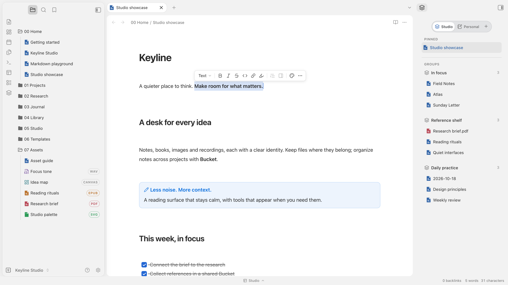
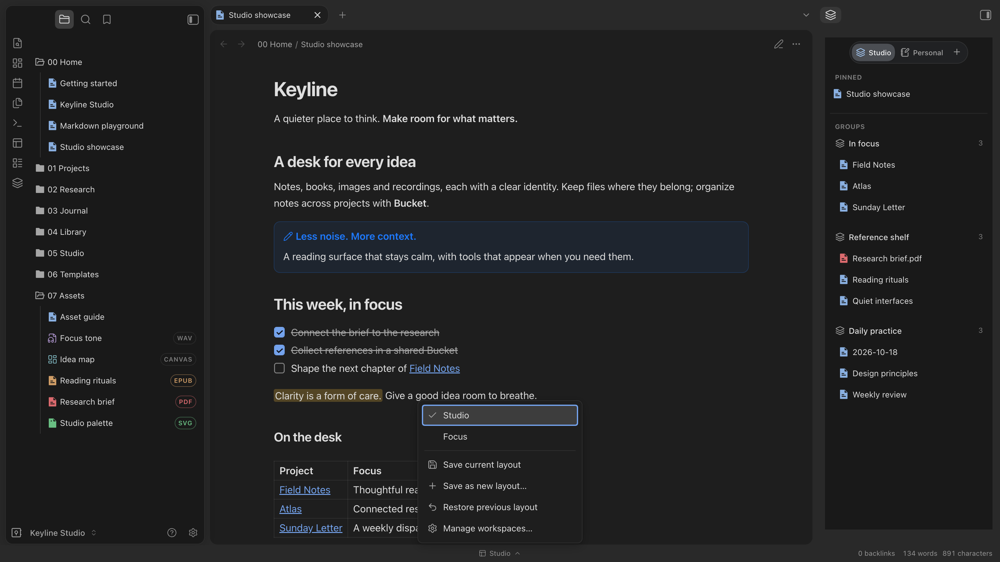
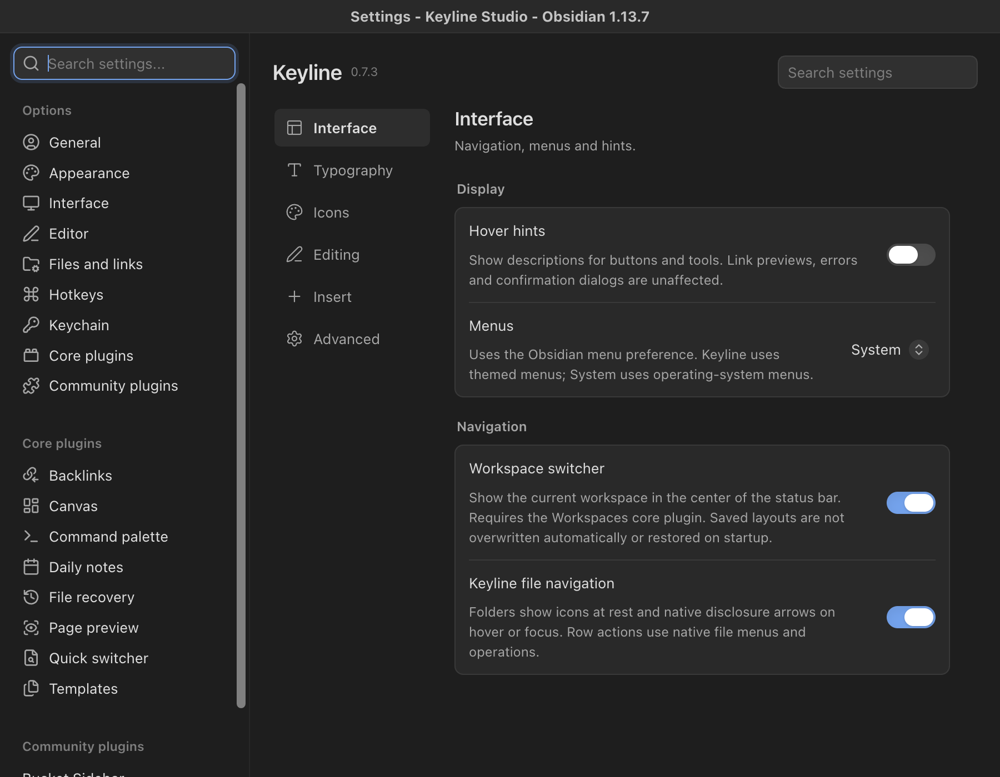

# Keyline 交互插件

[Keyline 主题](https://github.com/BADtoBad/obsidian-keyline)的可选编辑与导航组件。

[English](README.md) · [下载](https://github.com/BADtoBad/keyline-interactions/releases)

**建议搭配 Keyline 主题安装，以获得下方截图中的编辑体验。** 本插件在 Obsidian 插件列表中的名称是 **Keyline**，不是主题本体。[Bucket Sidebar](https://github.com/BADtoBad/obsidian-bucket-sidebar) 是另一个可选的分组侧栏插件；主题可以不装这两个插件，本插件也不依赖 Bucket。

当前为 **GitHub 预览版**，请按下方说明手动安装，尚不能在 Community 目录中安装。

## 功能

- 段落拖动、上下文插入菜单与选区格式工具栏。
- `@` 打开日期、时间和页面建议；只有主动选择页面时才生成双向链接，关闭菜单不会改写原文。
- 原生文件导航的图标与快捷操作，不接管文件读写规则。
- 居中的底栏工作区切换器，使用 Obsidian 核心 Workspaces 数据。
- 可搜索的“界面、排版、图标、编辑、插入、高级”六类设置。
- 中英文菜单、设置与提示，跟随 Obsidian 界面语言，切换后重启生效。不会翻译笔记、路径或自定义名称。

## 功能截图

以下是虚构、全英文 [Keyline Studio 示例库](https://github.com/BADtoBad/obsidian-keyline#try-the-example-vault)在 Obsidian 内的真实截图，搭配了可选的 Keyline 主题。**右侧分组面板来自 Bucket Sidebar**，不属于本插件功能。

### 亮色：编辑与分类图标

选中文字后显示格式工具栏。左侧原生文件浏览器用不同图标区分笔记、音频、Canvas、EPUB、PDF 与图片。图标只负责识别类型，不会为不支持的文件格式添加阅读器。

### 暗色：工作区切换

底栏居中按钮向窗口内弹出已保存布局菜单，使用 Obsidian 核心插件 **Workspaces**。

### 分类清楚的双语设置

可搜索“界面、排版、图标、编辑、插入、高级”六类设置。截图为 0.7.3 的英文界面，0.7.4 保留该布局；中文使用相同控件，跟随 Obsidian 语言，切换后重启生效。

## 安装与升级

需要 **Obsidian 1.7.7 或更新的桌面版**。先备份 `.obsidian` 并关闭该库，将 Releases 的 `main.js`、`manifest.json`、`styles.css` 放入：

`.obsidian/plugins/notion-craft-interaction-lab/`

保留旧 ID 是为了兼容升级，不要覆盖自己的 `data.json`。重新打开 Obsidian，在第三方插件中启用 **Keyline**。停用插件不会删除 Markdown 笔记。

工作区切换依赖核心插件 **Workspaces**，请避免同时运行其他自动切换器。Iconic、图标插件和布局片段可能覆盖相同界面，建议先在测试库中检查组合效果。

Marginalia 是独立插件，不包含在本包中；未安装时相关操作不可用。常规编辑操作不请求远程网络。

## 构建

使用 Node.js 22 和 pnpm 10.11.0，依次运行 `pnpm install --frozen-lockfile`、`pnpm typecheck`、`pnpm lint`、`pnpm pretest`、`pnpm test`、`pnpm build`。

正式构建只生成本地文件。仅在明确设置 `VAULT_PLUGIN_DIR` 时，开发构建才复制到指定 Vault。

## 发行与许可

公开预览版 **0.7.4**。尚缺公开书面的上游独立发布同意，因此暂不提交 Community。自动化和 macOS 检查详见 [发行验证](RELEASE-VERIFICATION.md)，不宣称所有老 Mac 和插件组合均已验证。反馈时请提供不含隐私的复现步骤。

## 来源

Keyline 交互插件基于本地 Notion Markdown Guard 分叉；上游为 [Feel the Notion](https://github.com/MichaelNguyen5653/feel-the-notion) 0.6.0（快照 `92eea6ba535376e1e56527e5a28c3a11cc994c4d`）和 [BCS1037/notion-block](https://github.com/BCS1037/notion-block) 1.4.0。保留原 MIT 版权声明，独立名称不代表独立起源或获得上游背书。

MIT，版权与第三方声明见 [LICENSE](LICENSE) 和 [THIRD_PARTY_NOTICES.md](THIRD_PARTY_NOTICES.md)。
